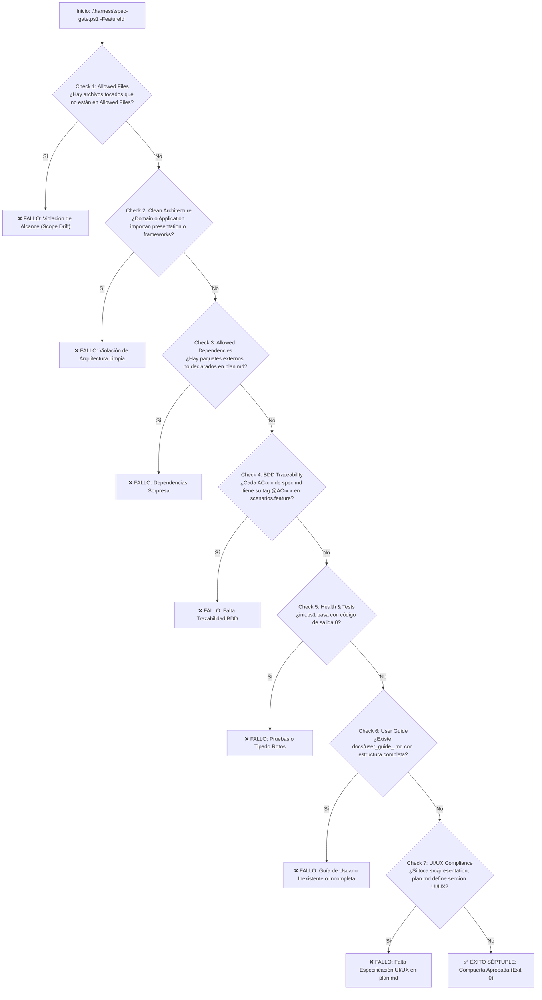
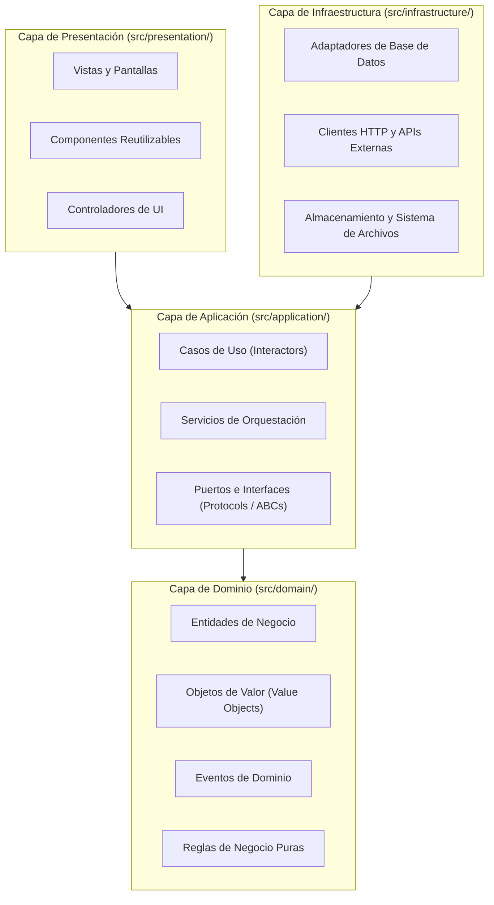
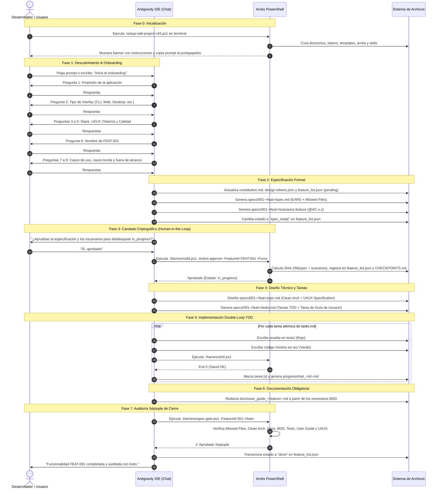

# Guía Maestra Exhaustiva: Arquitectura, Artefactos y Gobierno de Setup SDD (v4.3)

---

## 1. Introducción y Fundamentos Metodológicos

El framework **Setup SDD (Spec-Driven Development v4.3)** es una infraestructura integral de ingeniería de software diseñada para garantizar que el desarrollo asistido por Inteligencia Artificial (IA) se mantenga rigurosamente alineado con especificaciones ejecutables, arquitectura limpia y verificación automatizada.

El sistema fusiona tres disciplinas fundamentales:
1. **Spec-Driven Development (SDD):** El código es un derivado formal de la especificación; ninguna línea de producción puede existir sin un requerimiento que la justifique.
2. **Behavior-Driven Development (BDD):** Los requisitos funcionales se expresan en lenguaje de negocio mediante sintaxis **EARS** (Easy Approach to Requirements Syntax) y escenarios ejecutables **Gherkin** (`# language: es`).
3. **Clean Architecture (Arquitectura Limpia):** Separación estricta de responsabilidades en cuatro capas concéntricas (`domain`, `application`, `infrastructure` y `presentation`), con reglas de dependencia estrictas e inviolables.
4. **UI/UX Pro Max (Design-System First):** Gobernanza visual formal a través de tokens de diseño (`design-tokens.json`), especificación previa de componentes, 5 estados obligatorios y accesibilidad universal (WCAG 2.1 AA).
5. **Criptografía Human-in-the-Loop:** Un candado criptográfico inmutable basado en **SHA-256** previene modificaciones no autorizadas (*Spec Tampering*) y garantiza que sólo el humano autoriza el paso al desarrollo activo.

---

## 2. Mapa Completo del Árbol de Directorios y Archivos

Al ejecutarse `setup-sdd-project-v43.ps1`, se genera la siguiente topología de archivos y directorios:

```text
<RAÍZ_DEL_PROYECTO>/
│
├── .agents/
│   └── skills/                                 # 12 Skills operativas del Agente de IA
│       ├── sdd-onboard.md                      # Entrevista inicial guiada (1 pregunta por turno)
│       ├── sdd-constitution.md                 # Administración de leyes inmutables
│       ├── sdd-specify.md                      # Redacción de spec.md (EARS) y scenarios.feature
│       ├── sdd-clarify.md                      # Auditoría adversarial de ambigüedades
│       ├── sdd-ui-ux.md                        # Inteligencia de diseño visual y accesibilidad
│       ├── sdd-plan.md                         # Plan técnico Clean Arch + UI/UX Specification
│       ├── sdd-tasks.md                        # Desglose en tareas TDD atómicas + Guía de Usuario
│       ├── sdd-implement.md                    # Ejecución Double-Loop BDD/TDD
│       ├── sdd-user-guide.md                   # Redacción de la Guía de Usuario obligatoria
│       ├── sdd-validate.md                     # Auditoría de cierre con el Auditor Séptuple
│       ├── sdd-change-spec.md                  # Control estricto de cambios (Anti-Spec-Drift)
│       └── sdd-reverse-spec.md                 # Ingeniería inversa brownfield para código heredado
│
├── .specify/                                   # Memoria, tokens y plantillas canónicas
│   ├── memory/
│   │   └── constitution.md                     # Constitución: reglas inmutables de calidad y stack
│   ├── design-system/
│   │   └── design-tokens.json                  # Tokens UI/UX: arquetipo, paleta, tipografía y estados
│   ├── templates/                              # Plantillas maestras estructurales
│   │   ├── spec.template.md                    # Plantilla de especificación funcional EARS
│   │   ├── scenarios.template.feature          # Plantilla de escenarios Gherkin (@AC-x.x)
│   │   ├── plan.template.md                    # Plantilla de arquitectura y UI/UX Design System
│   │   ├── tasks.template.md                   # Plantilla de desglose de tareas TDD
│   │   ├── user_guide.template.md              # Plantilla obligatoria de Guía de Usuario
│   │   └── impl_report.template.md             # Plantilla de reporte de implementación TDD
│   └── harness-config.json                     # Configuración políglota de linter, tests y reglas
│
├── harness/                                    # Scripts de gobernanza, pruebas y compuertas
│   ├── init.ps1                                # Validador de salud, anti-tampering y tests
│   ├── sdd.ps1                                 # Orquestador del backlog y candado SHA-256
│   └── spec-gate.ps1                           # Auditor Séptuple de cierre de funcionalidad
│
├── specs/                                      # Directorio de especificaciones por feature
│   └── <feature_dir>/                          # Ej: 001-tablero-kanban-principal/
│       ├── spec.md                             # Especificación EARS con Allowed Files
│       ├── scenarios.feature                   # Escenarios BDD Gherkin
│       ├── plan.md                             # Plan técnico con UI/UX Design System
│       └── tasks.md                            # Checklist atómico de desarrollo
│
├── docs/                                       # Documentación orientada al usuario final
│   └── user_guide_<feature_dir>.md             # Guía de usuario obligatoria para cada feature
│
├── progress/                                   # Trazabilidad técnica del desarrollo
│   └── impl_<id>.md                            # Informes de tareas TDD de Rojo a Verde
│
├── src/                                        # Código fuente bajo Clean Architecture estricta
│   ├── domain/                                 # Entidades puras, Value Objects y Reglas de Negocio
│   ├── application/                            # Casos de Uso, Puertos y Servicios de Aplicación
│   ├── infrastructure/                         # Adaptadores, repositorios DB, clientes HTTP
│   └── presentation/                           # Componentes de UI, controladores y vistas
│
├── tests/                                      # Suite de pruebas automatizadas
│   ├── unit/                                   # Pruebas unitarias de dominio y aplicación
│   └── acceptance/                             # Step definitions BDD (ej. pytest-bdd, behave)
│
├── .git/hooks/
│   └── pre-commit                              # Hook nativo Git que ejecuta harness\init.ps1
│
├── .gitignore                                  # Reglas de exclusión para Python, Node, IDEs y OS
├── AGENTS.md                                   # Contrato operativo y leyes del Agente en Windows
├── anti-gravity.md                             # Directrices específicas para Google Antigravity IDE
├── feature_list.json                           # Registro central del backlog con estados y hashes
└── CHECKPOINTS.md                              # Libro contable inmutable de auditorías humanas
```

---

## 3. Descripción Meticulosa de Cada Artefacto y Archivo

### 3.1. Artefactos de la Raíz

#### `feature_list.json`
Es la base de datos central y minimalista del backlog del proyecto. Cada objeto representa una funcionalidad con el siguiente esquema estricto:

```json
[
  {
    "id": "FEAT-001",
    "name": "Tablero Kanban Principal",
    "description": "Flujo principal y vistas iniciales para Tablero Kanban Principal",
    "feature_dir": "001-tablero-kanban-principal",
    "status": "pending",
    "approval_hash": "",
    "approved_at": ""
  }
]
```

* **Campos:**
  - `id`: Identificador alfanumérico secuencial (`FEAT-001`, `FEAT-002`).
  - `name`: Nombre descriptivo de la funcionalidad.
  - `description`: Resumen conciso del objetivo de negocio.
  - `feature_dir`: Nombre del directorio correspondiente dentro de `specs/`.
  - `status`: Estado actual dentro del ciclo de vida (`pending` $\rightarrow$ `spec_ready` $\rightarrow$ `in_progress` $\rightarrow$ `review` $\rightarrow$ `done`).
  - `approval_hash`: Firma criptográfica SHA-256 calculada sobre `spec.md` y `scenarios.feature`. Vacía hasta que el humano autoriza formalmente.
  - `approved_at`: Timestamp ISO 8601 (`yyyy-MM-ddTHH:mm:ssZ`) de la aprobación humana.

#### `CHECKPOINTS.md`
Es el libro contable de auditoría formal humana. Funciona como un registro de sólo adición (*append-only*). Cada vez que una funcionalidad es aprobada mediante el candado criptográfico, se agrega una entrada inmutable:

```markdown
# Registro de Checkpoints Humanos (Inmutable)

| Timestamp | Feature ID | Feature Name | Approval SHA-256 (Primeros 16 chars) | Estado |
|---|---|---|---|---|
| 2026-10-23T15:45:00Z | FEAT-001 | Tablero Kanban Principal | a3f5b891e42c8d10 | in_progress |
```

#### `AGENTS.md`
El contrato operativo primordial del Agente de IA. Define:
1. **Resumen del Proyecto:** Contexto de arquitectura limpia y desarrollo guiado por especificaciones sobre Windows.
2. **Protocolo Obligatorio de Inicio:** Obligación de ejecutar `.\harness\init.ps1` antes de proponer cambios. Prohibición tajante de tocar `src/` sin especificación aprobada.
3. **Leyes Inmutables:** La spec manda, Clean Architecture estricta, cero dependencias sorpresa, trazabilidad BDD total, candado SHA-256 inmutable y Guía de Usuario obligatoria.
4. **Cero Fricción en Antigravity IDE:** El agente interactúa mediante el chat, formula preguntas al usuario y ejecuta las herramientas de arnés internamente sin obligar al usuario a manipular la terminal manualmente.

#### `anti-gravity.md`
Directrices de entorno adaptadas para **Google Antigravity IDE**:
* Enlace jerárquico a `@AGENTS.md`.
* Uso exclusivo de comandos nativos de PowerShell (`.\harness\init.ps1`, etc.).
* **Regla Anti-Teléfono-Descompuesto:** Prohibición de transferir bloques gigantescos de código a través del chat; en su lugar, se registran reportes concisos en `progress/impl_<id>.md` y se responden enlaces a archivos en disco.

#### `.gitignore`
Configuración que evita ensuciar el repositorio con artefactos transitorios:
* Entornos virtuales (`.venv/`, `venv/`, `env/`).
* Caché de Python (`__pycache__/`, `*.pyc`).
* Node / TypeScript (`node_modules/`, `dist/`).
* Cobertura y testing (`.pytest_cache/`, `.coverage`, `coverage/`).
* Archivos del sistema operativo (`Thumbs.db`, `.DS_Store`).

#### `.git/hooks/pre-commit`
Hook nativo de Git que intercepta cada `git commit`:
* Ejecuta automáticamente `powershell -ExecutionPolicy Bypass -File .\harness\init.ps1`.
* Si las pruebas fallan, el tipado estático no pasa, hay violación de imports de dominio o se detecta alteración de especificaciones (*Spec Tampering*), el commit se cancela inmediatamente con código de salida `1`.

---

### 3.2. Configuración y Memoria (`.specify/`)

#### `.specify/harness-config.json`
El motor políglota que le enseña al arnés cómo auditar el stack tecnológico del proyecto:

```json
{
  "stack": "python",
  "source_dir": "src",
  "test_dir": "tests",
  "file_extension": "*.py",
  "typecheck_cmd": "python -m mypy src --ignore-missing-imports",
  "test_cmd": "python -m pytest -q tests",
  "forbidden_domain_imports": [
    "fastapi", "flask", "django", "starlette", "requests",
    "httpx", "aiohttp", "sqlalchemy", "peewee", "pymongo", "psycopg2",
    "tkinter", "PyQt5", "PyQt6", "PySide2", "PySide6", "flet", "streamlit", "gradio"
  ]
}
```

* **Aislamiento de Dominio:** Cualquier intento de importar frameworks web, librerías HTTP, ORMs o librerías de interfaz gráfica dentro de `src/domain/` o `src/application/` es detectado por `init.ps1` y rechazado al instante.

#### `.specify/memory/constitution.md`
Documento de gobernanza que almacena las 6 leyes innegociables del proyecto:
1. **La Spec Manda:** Ningún código sin requerimiento formal en `spec.md`.
2. **Clean Architecture:** Dominio y aplicación 100% aislados de frameworks y presentación.
3. **Double-Loop TDD:** Desarrollo mediante dos bucles: bucle externo de aceptación BDD (Rojo $\rightarrow$ Verde) y bucle interno de pruebas unitarias TDD.
4. **Guía de Usuario Obligatoria:** Ninguna feature se da por concluida sin `docs/user_guide_<feature>.md`.
5. **UI/UX Tokens:** Toda interfaz en `src/presentation/` debe regirse por los tokens de diseño.
6. **Aprobación Humana Inmutable:** Estado `in_progress` desbloqueado únicamente con firma SHA-256.

#### `.specify/design-system/design-tokens.json`
El repositorio de inteligencia de diseño (**UI/UX Pro Max**):
* **`visual_archetype`:** Arquetipo de interfaz (`modern_clean_saas`, `minimalist`, `bento_grid`, etc.).
* **`color_palette`:** Paleta estructurada en hexadecimal (`primary`, `primary_hover`, `secondary`, `background`, `surface`, `text_primary`, `text_secondary`, `border`, `success`, `warning`, `error`).
* **`typography`:** Familias tipográficas para UI y código monoespaciado, junto a la escala tipográfica modular (`h1` a `caption`).
* **`spacing`:** Escala de espaciado armónico (`xs` de 4px a `2xl` de 48px).
* **`component_mandatory_states`:** Exigencia formal de que cada componente visual defina sus 5 estados:
  1. `default`: Reposo estándar.
  2. `hover_focus`: Foco para accesibilidad de teclado y ratón.
  3. `loading_skeleton`: Retroalimentación de operaciones asíncronas.
  4. `empty`: Estado cuando no hay información disponible.
  5. `error`: Estado ante entradas inválidas o fallos.

---

### 3.3. Plantillas Maestras (`.specify/templates/`)

#### `spec.template.md`
Estructura obligatoria para la especificación funcional:
* `## 1. Contexto e Historia de Usuario`: Formato clásico *«Como [rol], quiero [acción], para [beneficio]»*.
* `## 2. Criterios de Aceptación (Sintaxis EARS)`:
  - **Ubicuo:** *«EL SISTEMA DEBE [acción] siempre.»*
  - **Disparado por evento:** *«CUANDO [evento], EL SISTEMA DEBE [respuesta].»*
  - **Manejo de error:** *«SI [condición de fallo], ENTONCES EL SISTEMA DEBE [manejo específico].»*
  - **Basado en estado:** *«MIENTRAS [sistema en estado X], EL SISTEMA DEBE [comportamiento continuo].»*
* `## 3. Casos Borde y Manejo de Errores`: Escenarios límite y validaciones.
* `## 4. Fuera de Alcance (Out of Scope)`: Fronteras claras de la entrega.
* `## 5. Allowed Files`: Lista blanca de archivos que la feature tiene permiso de crear o editar.
* `## 6. Requerimientos No Funcionales & UI/UX`: Contraste $\ge 4.5:1$, navegación por teclado, accesibilidad WCAG 2.1 AA.

#### `scenarios.template.feature`
Plantilla Gherkin en español (`# language: es`):
* Cada escenario debe llevar una etiqueta que corresponda exactamente a un criterio de aceptación de la spec: `@AC-1.1`, `@AC-1.2`, etc.
* Escenarios expresados en términos de negocio y semántica accesible (roles, atributos ARIA, estados visibles), prohibiéndose aserciones frágiles vinculadas a clases CSS cosméticas.

#### `plan.template.md`
Diseño técnico previo a la programación:
* `## 1. Clean Architecture Breakdown`: Asignación de responsabilidades en `domain`, `application`, `infrastructure` y `presentation`.
* `## 2. UI/UX Design System Specification`: Tokens de color, escala tipográfica, arquetipo y definición explícita de los 5 estados para cada componente visual.
* `## 3. Testing Strategy Matrix`: Matriz de correspondencia entre escenarios BDD y pruebas unitarias TDD.
* `## 4. Allowed Dependencies`: Lista blanca de librerías externas autorizadas.

#### `tasks.template.md`
Desglose del plan en tareas atómicas TDD (20 a 30 minutos por tarea):
* Cada tarea técnica especifica la prueba que pasará de Rojo a Verde.
* Incluye de forma innegociable la tarea final: `[ ] Redactar Guía de Usuario en docs/user_guide_<feature>.md`.

#### `user_guide.template.md`
Plantilla para la Guía de Usuario obligatoria:
* Diseñada para el usuario final del sistema, no para desarrolladores.
* Contiene: Resumen, Prerrequisitos, Tutorial Paso a Paso con escenarios reales, Casos Borde y Preguntas Frecuentes, y Referencia Visual de la Interfaz.

#### `impl_report.template.md`
Evidencia documental de la ejecución TDD para cada tarea completada.

---

### 3.4. El Arnés de Calidad y Gobernanza (`harness/`)

#### `harness/init.ps1`
Es el guardián de salud del entorno. Realiza 5 comprobaciones críticas:
1. **Integridad del Backlog:** Comprueba que `feature_list.json` sea un JSON válido.
2. **Límite Mono-Tarea:** Verifica que exista **como máximo 1 funcionalidad** en estado `in_progress`.
3. **Detección de Manipulación (Anti-Tampering):**
   $$\text{HashActual} = \text{SHA256}(\text{spec.md} + \text{"---"} + \text{scenarios.feature})$$
   Si $\text{HashActual} \neq \text{approval\_hash}$, aborta con el error `[Spec Tampering]`, obligando a re-aprobar formalmente la especificación modificada.
4. **Pureza de Arquitectura Limpia:** Escanea `src/domain/` y `src/application/` buscando cadenas de imports pertenecientes a `forbidden_domain_imports` o referencias a `presentation`.
5. **Ejecución de Pruebas:** Ejecuta `typecheck_cmd` y `test_cmd`.

#### `harness/sdd.ps1`
El orquestador de la máquina de estados del proyecto:
* `.\harness\sdd.ps1 -Action status`: Imprime el estado visual del backlog con colores y los primeros 8 caracteres de sus firmas criptográficas.
* `.\harness\sdd.ps1 -Action next`: Inspecciona el backlog y determina la acción inmediata según el estado de la funcionalidad activa.
* `.\harness\sdd.ps1 -Action approve -FeatureId <id> [-Force]`: 
  - Calcula la firma criptográfica SHA-256 de la especificación.
  - Actualiza `status` a `in_progress` en `feature_list.json`.
  - Registra el timestamp y hash en `CHECKPOINTS.md`.
  - El modificador `-Force` permite al Agente de Antigravity IDE autorizar el paso automáticamente cuando el humano da su confirmación en el chat.
* `.\harness\sdd.ps1 -Action verify`: Corre `init.ps1`.

#### `harness/spec-gate.ps1` (El Auditor Séptuple)
La compuerta de verificación más estricta del framework. Valida 7 aspectos antes de permitir el cierre de una feature:



---

### 3.5. Las 12 Habilidades Agénticas (`.agents/skills/`)

| Skill | Archivo | Rol y Responsabilidad Primaria |
|---|---|---|
| **SDD Onboard** | `sdd-onboard.md` | Conduce la entrevista de descubrimiento formulando **exactamente 1 pregunta por turno** en el chat (propósito, interfaz, stack, UI/UX, calidad, primera feature). Configura `constitution.md`, `design-tokens.json` y redacta la primera spec. |
| **SDD Constitution** | `sdd-constitution.md` | Custodia las leyes del proyecto. Sincroniza `constitution.md` con las reglas de `harness-config.json`. |
| **SDD Specify** | `sdd-specify.md` | Redacta formalmente `specs/<feature>/spec.md` con sintaxis EARS y delimitación de `## 5. Allowed Files`, más `scenarios.feature` con tags `@AC-x.x`. |
| **SDD Clarify** | `sdd-clarify.md` | Rol de QA adversarial: busca vacíos, inconsistencias, ambigüedades lógicas y criterios sin cobertura antes de que se diseñe el plan técnico. |
| **SDD UI/UX Pro Max** | `sdd-ui-ux.md` | Inteligencia de diseño visual: consulta tokens, define arquetipos, garantiza accesibilidad WCAG 2.1 AA (contraste $\ge 4.5:1$, navegación por teclado) y modela los 5 estados obligatorios. |
| **SDD Plan** | `sdd-plan.md` | Traduce los requerimientos en arquitectura modular limpia (`domain`, `application`, `infrastructure`, `presentation`), define la especificación UI/UX formal y lista las dependencias permitidas. |
| **SDD Tasks** | `sdd-tasks.md` | Descompone `plan.md` en tareas TDD atómicas ejecutables de 20 a 30 minutos, incluyendo la tarea de redacción de la Guía de Usuario. |
| **SDD Implement** | `sdd-implement.md` | Ejecuta la tarea activa aplicando el doble bucle TDD: escribe el test en Rojo, implementa el código mínimo en Verde, valida con `.\harness\init.ps1` y guarda la evidencia en `progress/impl_<id>.md`. |
| **SDD User Guide** | `sdd-user-guide.md` | Redacta y valida la Guía de Usuario en `docs/user_guide_<feature>.md` orientada al usuario final a partir de los escenarios BDD verificados. Requisito indispensable para superar el Check 6 de `spec-gate.ps1`. |
| **SDD Validate** | `sdd-validate.md` | Audita el cierre formal de la funcionalidad ejecutando `.\harness\spec-gate.ps1` y verificando `CHECKPOINTS.md`. |
| **SDD Change Spec** | `sdd-change-spec.md` | Intercepta solicitudes de cambio en funcionalidades existentes o concluidas: exige actualizar primero `spec.md` y `scenarios.feature`, y re-aprobar el hash SHA-256 antes de permitir tocar código fuente. |
| **SDD Reverse Spec** | `sdd-reverse-spec.md` | Ingeniería inversa para código heredado (*brownfield*): analiza módulos existentes y genera una especificación retrospectiva antes de refactorizar. |

---

### 3.6. Estructura de Código Fuente (`src/`) y Pruebas (`tests/`)



* **Regla de Dependencia Unidireccional:** Las capas exteriores (`presentation` e `infrastructure`) conocen a la capa de `application`. La capa de `application` conoce únicamente al `domain`. El `domain` no conoce absolutamente nada del exterior (cero imports de FastAPI, Flask, SQL, React, PyQt, etc.).

---

## 4. Ciclo de Vida Completo de una Funcionalidad (Paso a Paso)



---

## 5. Tabla Resumen de Comandos del Desarrollador

| Operación | Comando en Terminal | Rol en el Flujo |
|---|---|---|
| **Inicializar Proyecto** | `powershell -ExecutionPolicy Bypass -File .\setup-sdd-project-v43.ps1` | Crea toda la infraestructura, tokens y skills. Se ejecuta **una sola vez** al inicio del proyecto. |
| **Consultar Backlog** | `.\harness\sdd.ps1 -Action status` | Muestra el estado de todas las funcionalidades, colores de progreso y los primeros 8 caracteres de sus firmas SHA-256. |
| **Avanzar / Siguiente Paso** | `.\harness\sdd.ps1 -Action next` | Guía el paso inmediato a seguir para la funcionalidad activa en el backlog. |
| **Aprobar Criptográficamente** | `.\harness\sdd.ps1 -Action approve -FeatureId <id>` | Activa el candado criptográfico con confirmación manual del humano en consola. |
| **Aprobación desde IDE** | `.\harness\sdd.ps1 -Action approve -FeatureId <id> -Force` | Invocado por el Agente de Antigravity IDE tras recibir el "Sí" del humano en el chat. |
| **Validar Salud y Tests** | `.\harness\init.ps1` | Comprueba anti-tampering, pureza de arquitectura, tipado estático y pruebas. |
| **Auditar Cierre de Feature** | `.\harness\spec-gate.ps1 -FeatureId <directorio>` | Ejecuta la auditoría séptuple estricta antes de dar una feature por concluida. |

---

## 6. Conclusión

El framework **Setup SDD v4.3** transforma el desarrollo asistido por IA de un proceso caótico y propenso a alucinaciones en un **flujo de ingeniería determinista, auditable y de grado empresarial**:
* Cada función escrita responde a un criterio de aceptación comprobable.
* Cada pantalla respeta un sistema de diseño estandarizado y accesible.
* Cada usuario final recibe una guía de uso clara y comprensible.
* El humano mantiene el control total mediante firmas criptográficas inmutables.
