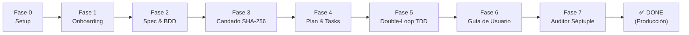
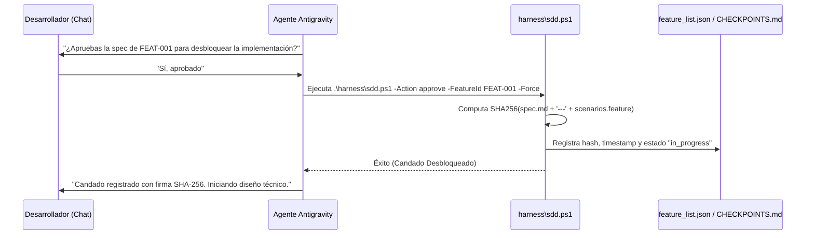

# Presentación: Secuencia de Operación de Setup SDD (v4.3)

> **Subtítulo:** Ciclo de Vida Determinista de Ingeniería de Software con Agentes de IA  
> **Metodologías:** Spec-Driven Development (SDD) • Behavior-Driven Development (BDD) • Clean Architecture • UI/UX Pro Max • Candado Criptográfico SHA-256  
> **Versión:** 4.3 (Enterprise Edition)

---

## Diapositiva 1: Visión General del Flujo



### Principio Rector
> **«La especificación manda»**: Ninguna línea de código de producción puede existir en `src/` sin estar justificada por un requerimiento EARS formal, respaldada por un escenario BDD Gherkin y autorizada por una firma criptográfica humana.

---

## Diapositiva 2: Fase 0 — Inicialización de Infraestructura

* **Actor:** Desarrollador (ejecución única en PowerShell).
* **Comando:**
  ```powershell
  powershell -ExecutionPolicy Bypass -File .\setup-sdd-project-v43.ps1
  ```
* **Acciones Automáticas Realizadas:**
  1. **Árbol de Directorios:** Crea `src/domain`, `src/application`, `src/infrastructure` y `src/presentation`.
  2. **Inteligencia de Diseño:** Genera `.specify/design-system/design-tokens.json` con tokens de color, tipografía y los 5 estados obligatorios.
  3. **Templates Canónicos:** Genera plantillas EARS, Gherkin, plan técnico, tareas TDD y Guía de Usuario.
  4. **Arnés de Calidad:** Genera `harness/init.ps1`, `harness/sdd.ps1` y `harness/spec-gate.ps1`.
  5. **Git Hook Pre-Commit:** Instala `.git/hooks/pre-commit` para bloquear commits si el arnés detecta fallos.
  6. **12 Skills Agénticas:** Despliega las habilidades en `.agents/skills/`.
* **Resultado:** Copia automáticamente el prompt al portapapeles y notifica al usuario que pase al panel de chat de Antigravity IDE.

---

## Diapositiva 3: Fase 1 — Descubrimiento & Onboarding Conversacional

* **Actor:** Desarrollador + Agente de IA en el panel de chat (**Agent**) de Antigravity IDE.
* **Skill Activa:** `sdd-onboard.md`.
* **Regla Fundamental:** **Exactamente 1 pregunta por turno** (cero abrumar al usuario con formularios gigantescos).
* **Las 9 Preguntas de Descubrimiento:**
  1. **Propósito:** ¿Qué problema clave resuelve la aplicación?
  2. **Tipo de Interfaz:** CLI/TUI, Web Frontend, Móvil, Desktop o Backend sin UI.
  3. **Stack Tecnológico:** Lenguaje, versión y librerías clave.
  4. **UI/UX Intelligence:** Arquetipo visual (*Modern Clean SaaS, Minimalista, Bento Grid*), paleta cromática y accesibilidad WCAG 2.1 AA (o `headless`).
  5. **Calidad:** Linter, analizador de tipos y test runner.
  6. **Primera Funcionalidad:** Nombre y alcance de `FEAT-001`.
  7. **Historia de Usuario:** Rol, acción y beneficio esperado.
  8. **Casos Borde & Estados UI:** Errores, loading, empty state y feedback accesible.
  9. **Fuera de Alcance (*Out of Scope*):** Fronteras explícitas de lo que no se construirá.
* **Artefactos Producidos:**
  - `.specify/memory/constitution.md` (Constitución y leyes del proyecto).
  - `.specify/design-system/design-tokens.json` (Tokens adaptados).
  - `feature_list.json` con `FEAT-001` registrado en estado `"pending"`.

---

## Diapositiva 4: Fase 2 — Especificación Formal y BDD

* **Skills Activas:** `sdd-specify.md` + `sdd-clarify.md` (Auditoría adversarial).
* **Artefactos Generados en `specs/001-<feature_dir>/`:**
  1. **`spec.md` (Sintaxis EARS):**
     - Criterios de aceptación con disparadores:
       - `CUANDO` [evento], `EL SISTEMA DEBE` [resultado].
       - `SI` [condición de error], `ENTONCES EL SISTEMA DEBE` [manejo].
       - `MIENTRAS` [estado activo], `EL SISTEMA DEBE` [comportamiento continuo].
     - **`## 5. Allowed Files`:** Lista blanca estricta de archivos permitidos.
  2. **`scenarios.feature` (Gherkin en Español):**
     - Etiquetado formal `@AC-x.x` para cada criterio de aceptación.
     - Basado en roles semánticos y estados de interfaz.
     - **Prohibido:** Aserciones frágiles de clases CSS cosméticas.
* **Transición de Estado:** `status` pasa a `"spec_ready"` en `feature_list.json`.

---

## Diapositiva 5: Fase 3 — Candado Criptográfico Human-in-the-Loop



* **Anti-Spec Tampering:** En cada ejecución subsiguiente, `init.ps1` recomputa el hash SHA-256 en tiempo real. Si alguien modifica `spec.md` o `scenarios.feature` sin autorización, el arnés se bloquea automáticamente.

---

## Diapositiva 6: Fase 4 — Diseño Técnico y Desglose de Tareas

* **Skills Activas:** `sdd-plan.md` + `sdd-tasks.md` + `sdd-ui-ux.md`.
* **Artefactos Generados en `specs/001-<feature_dir>/`:**
  1. **`plan.md`:**
     - **Clean Architecture Breakdown:** Separación en `domain` (lógica pura), `application` (casos de uso), `infrastructure` (adaptadores/DB) y `presentation` (vistas/componentes).
     - **UI/UX Design System Specification:** Definición de componentes visuales con sus **5 estados obligatorios**: *Default, Hover/Focus, Loading/Skeleton, Empty State y Error State*.
     - **Allowed Dependencies:** Lista blanca de librerías aprobadas (cero paquetes sorpresa).
  2. **`tasks.md`:**
     - Tareas atómicas de 20 a 30 minutos.
     - Cada tarea especifica la prueba automatizada que pasará de Rojo a Verde.
     - **Tarea obligatoria innegociable:** Redacción de la Guía de Usuario en `docs/user_guide_<feature>.md`.

---

## Diapositiva 7: Fase 5 — Implementación Double-Loop TDD

* **Skill Activa:** `sdd-implement.md`.
* **Mecánica del Doble Bucle:**
  ```text
  [Bucle Externo: BDD Acceptance]
     └── 1. Escribir Step Definition BDD en tests/acceptance/ (Rojo)
          │
          ├── [Bucle Interno: TDD Unitario]
          │      ├── 2. Escribir Test Unitario en tests/unit/ (Rojo)
          │      ├── 3. Escribir código mínimo en src/ (Verde)
          │      └── 4. Refactorizar código y validar con .\harness\init.ps1
          │
          └── 5. Verificar que el escenario BDD pasa a Verde
  ```
* **Trazabilidad:** Cada tarea completada se marca `[x]` en `tasks.md` y produce un reporte técnico en `progress/impl_<id>.md`.

---

## Diapositiva 8: Fase 6 — Guía de Usuario Obligatoria

* **Skill Activa:** `sdd-user-guide.md`.
* **Artefacto:** `docs/user_guide_<feature_dir>.md`.
* **Propósito:** Documentación viva orientada exclusivamente al usuario final (no al desarrollador), derivada directamente de los escenarios Gherkin verificados.
* **Estructura Estándar:**
  1. **Resumen de la Funcionalidad:** Propósito y valor práctico.
  2. **Prerrequisitos:** Permisos, roles o datos previos necesarios.
  3. **Tutorial Paso a Paso:** Flujo con instrucciones claras.
  4. **Manejo de Errores y Preguntas Frecuentes:** Solución a fallos comunes.
  5. **Referencia Visual y Accesibilidad:** Estados de pantalla y atajos de teclado.

---

## Diapositiva 9: Fase 7 — Auditoría Séptuple y Cierre de Feature

* **Skill Activa:** `sdd-validate.md`.
* **Comando:**
  ```powershell
  .\harness\spec-gate.ps1 -FeatureId <feature_dir>
  ```
* **Las 7 Barreras Innegociables:**
  1. **Check 1 (Allowed Files):** Ningún archivo modificado fuera de la lista blanca de la spec.
  2. **Check 2 (Clean Architecture):** `domain` y `application` no importan presentación ni frameworks externos.
  3. **Check 3 (Allowed Dependencies):** Cero dependencias no autorizadas en `plan.md`.
  4. **Check 4 (BDD Traceability):** Cada criterio `AC-x.x` tiene su escenario `@AC-x.x`.
  5. **Check 5 (Health & Tests):** `init.ps1` pasa con código de salida `0` (tipado y pruebas verdes).
  6. **Check 6 (User Guide):** `docs/user_guide_<feature>.md` existe y está completo.
  7. **Check 7 (UI/UX Compliance):** Si se tocó `src/presentation/`, `plan.md` incluye especificación UI/UX válida.
* **Transición Final:** `status` cambia a `"done"` en `feature_list.json`. ¡Funcionalidad completada con certeza matemática!
